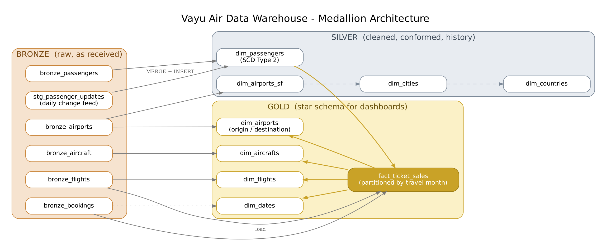

# Airline Data Warehouse

An end-to-end data warehouse for a fictional airline (Vayu Air), built in SQL Server. It turns raw booking-system data into a reporting-ready star schema, with full history tracking for customers, a date-partitioned fact table, layered data architecture and a data contract for the main source feed.

**Tools:** SQL Server, T-SQL, SSMS, Git



---

## About

The airline's booking system ran the business well, but every report queried the live transactional database directly. Reports were slow, hard to write, and teams got different numbers for the same question.

This project builds a dedicated analytics warehouse so that:
- revenue by route, month, fare class or loyalty tier can be answered quickly and consistently,
- historical reports stay accurate even when customer details change, and
- the source feed has clear rules on what data is expected and who owns it.

**Source data:** 6 raw tables: airports (24), aircraft (10), passengers (1,500), flights (2,000), bookings (40,000) and a daily passenger change feed (250).

---

## Approach

### 1. Layered architecture (medallion)
- **Bronze:** raw source tables, loaded as received.
- **Silver:** cleaned and conformed data, including the history-tracked passenger dimension and the normalised geography tables.
- **Gold:** the partitioned star schema that dashboards query.

### 2. Dimensional model (star schema)
- **Grain:** one row per booking: one passenger on one flight.
- **Fact table:** `fact_ticket_sales`, holding only surrogate keys and additive measures (fare, tax, loyalty miles).
- **Dimensions:** dates, passengers, flights, airports and aircraft. Each has an integer surrogate key and keeps its source business key.
- **Role-playing dimensions:** the date dimension is used for both booking date and travel date, and the airport dimension for both origin and destination.
- **One source of truth:** each attribute is stored in exactly one place. If a source code changes, only its dimension is updated and the fact is never touched.

### 3. Loading
- Dimensions are loaded first, then the fact, by matching each booking's business keys to the dimensions and storing their surrogate keys.
- The date dimension is generated with a recursive CTE covering every date in the data, keyed as yyyymmdd.
- **Checks:** fact row count matches the source (40,000), and every fact row links to all of its dimensions.

### 4. Customer history (SCD Type 2)
Passengers change loyalty tier and home airport over time. Overwriting those values would report past bookings under today's tier, so the passenger dimension keeps every version, with `is_current`, `effective_from` and `effective_to`.
- A two-step load expires changed rows and inserts brand-new passengers (MERGE), then opens a new version for each changed passenger (INSERT).
- **Result:** 200 passengers now have two versions, 50 new passengers have one, and no passenger ever has more than one current row.

### 5. Normalised geography (snowflake)
The airport table was also split into airport → city → country, so each country and city is stored once. This shows the trade-off between less repetition (snowflake) and fewer joins (star). The fact uses the star airport dimension for simpler, faster reporting.

### 6. Performance (partitioning)
The fact table is partitioned by travel month (15 monthly partitions) using a partition function and scheme.

| Query filter | Partitions read | Rows read |
|---|---|---|
| Travel date (partition column), June 2025 | **1 of 15** | **3,120** |
| Booking date (not the partition column), June 2025 | 15 of 15 | 40,000 |

Filtering on the partition column lets SQL Server skip every other month (partition elimination), confirmed in the actual execution plans:


### 7. Data contract
A contract for the bookings feed defines the schema and types, allowed values for fare class and booking status, a daily delivery SLA, ownership between producer and consumer teams, and how breaking vs non-breaking changes are handled.

---

## Repository structure

```
Airline_DataWarehouse/
├── sql/
│   ├── Q1.sql   Grain and column classification
│   ├── Q2.sql   Star schema tables
│   ├── Q3.sql   Dimension and fact loads
│   ├── Q4.sql   Snowflaked geography
│   ├── Q5.sql   SCD Type 2 passenger dimension
│   ├── Q6.sql   Date partitioning and execution plans
│   └── Q7.sql   Medallion layers and data contract
└── screenshots/  Architecture diagram and execution plans
```

## How to run
1. Create a `VayuAir` database in SQL Server and import the six source CSVs.
2. Run the scripts in `sql/` in order (2 to 6 build and load the warehouse; 1 and 7 are design notes).

## Limitations and next steps
- Booking status holds only the latest value; a transaction fact (one row per status change) would keep the full booking journey.
- The date dimension covers only the dates in the data; in production it would span a fixed range with holiday and fiscal-calendar columns.
- Next: move the transformations into dbt with automated tests, and build a Power BI dashboard on the gold layer.
